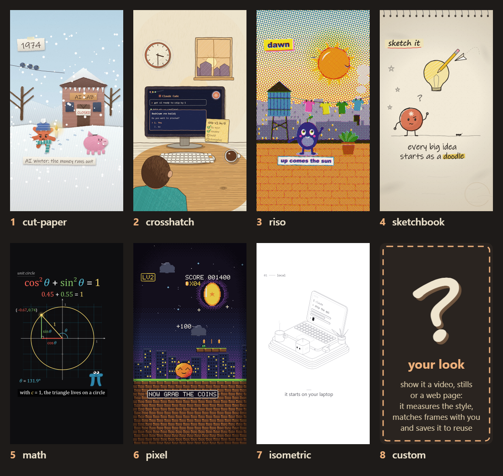

# Animate — procedural animation in any style, for Antigravity, OpenCode, Codex & Claude Code

A multi-agent plugin and skill that makes short animated videos entirely in code: one `<canvas>`, drawn and scored procedurally, deterministic frame by frame, rendered to MP4 with a headless browser and ffmpeg. Explainers, histories, little stories — in one of the built-in styles, or in a new look matched from your own references.



*The built-in styles, each a frame from its demo piece: cut paper, crosshatch ink, riso print, sketchbook, math, pixel, isometric — and the eighth slot: any other look, made from your references.*

## Supported Agents & Formats

| Platform | Skill Discovery Path | Plugin / Integration |
|---|---|---|
| **Google Antigravity** | `.agents/skills/animate/` · `~/.gemini/antigravity/skills/animate/` | `.antigravity-plugin/plugin.json` & root `plugin.json` (`agy plugin install .`) |
| **OpenCode** | `.opencode/skills/animate/` · `~/.config/opencode/skills/animate/` | `opencode.json` + `plugins/opencode-animate/` (`@opencode-ai/plugin` custom tools) |
| **OpenAI Codex CLI** | `.codex/skills/animate/` · `.agents/skills/animate/` · `~/.codex/skills/animate/` | `.codex-plugin/plugin.json` + root `AGENTS.md` |
| **Claude Code** | `plugins/animate/skills/animate/` · `~/.claude/skills/animate/` | `.claude-plugin/marketplace.json` |

## How it works

The skill walks you through a few questions, then makes you approve three cheap things before it spends time animating:

| step | what you see | you decide |
|---|---|---|
| 0. Intake | a handful of questions (subject, formats, voice, the look, hero, your music, your product) and the style gallery | answers, a style, or your references |
| 1. Story check | the format it picked and a numbered beat table, facts web-checked | approve / change beats |
| 2. Look check | 2–4 full-size style frames (for a new look: side-by-side comparisons with your references) | thumbs up per frame |
| 3. Storyboard | every beat as a key frame, with sound and the transition into the next | thumbs up/down by panel number |
| 4. Build | — (animate the approved panels, render, review) | — |
| 5. Delivery | the video plus measured checks: cuts on the beat grid, story arc loudness, hero anchoring, the loudest moment after the silence, narration pace | notes → a revision run |

## Styles

A style is a plug-in: the story grammar, timing, sound, renderer and tools stay the same; the style supplies the drawing kit. A piece picks one in its `piece.json` (`"style": "riso"`).

| style | the look |
|---|---|
| cut paper | torn paper, drop shadows, crayon, patterns, characters with faces |
| crosshatch | sketchy ink that boils on 2s, hatch and pencil shading, warm paper and navy "inside the machine" worlds |
| riso | a three-ink risograph print: halftone screens at their own angles, overprints, misregistration |
| sketchbook | graphite and one accent colour on a sketchbook page, hand lettering |
| math | a manim-style math explainer: black stage, axes and graphs, colour-coded variables, smooth easing |
| pixel | low-resolution eras: drawn at the true resolution, upscaled nearest-neighbour, a bitmap font |
| isometric | precise isometric line art: constant hairlines, white faces hiding what's behind, rounded slabs, one dark accent; light or dark ground |

**Your own look:** give the skill references (a video, stills, a web page) and it follows a procedure — measure the palette, line weight, texture, motion and cut rhythm; draw 1–2 matched frames next to your references (`tools/compare.mjs`); ask for your thumbs up; save it as `styles/<name>/` in your project so every later piece can use it. Reference media stays on your machine.

Each style folder has a `STYLE.md` (its rules, palette, motion habits and a frame checklist), a `kit.js`, a `sample.png` and a small `demo/` piece.

## Install

Requirements: Node 18+, [Playwright](https://playwright.dev) with Chromium, and `ffmpeg` on your PATH. Fonts are local system fonts with fallbacks for Windows, macOS and Linux. For voice-overs: Python with `faster-whisper` (word timing) and optionally ElevenLabs (API, MCP, or host connector) or local audio files.

```bash
npm i -g playwright && npx playwright install chromium
```

### Quick Install Script (All Platforms)

```bash
# Install globally for Antigravity, OpenCode, Codex, and Claude Code
node scripts/install.mjs --target all --scope global

# Or install into a specific project directory
node scripts/install.mjs --target antigravity --scope project --dest /path/to/project
node scripts/install.mjs --target opencode --scope project --dest /path/to/project
node scripts/install.mjs --target codex --scope project --dest /path/to/project
```

### Platform-Specific Setup

- **Google Antigravity:**
  ```bash
  agy plugin install .
  # or copy .agents/skills/animate/ -> ~/.gemini/antigravity/skills/animate/
  ```
- **OpenCode:**
  Clone or copy `opencode.json`, `.opencode/`, and `plugins/opencode-animate/` into your project (or install globally to `~/.config/opencode/`). The plugin registers 12 typed tools (`animate_gallery`, `animate_build`, `animate_still`, `animate_tile`, `animate_storyboard`, `animate_export`, `animate_review`, `animate_beats`, `animate_capture`, `animate_voice`, `animate_measure_refs`, `animate_compare`).
- **OpenAI Codex CLI:**
  Copy `.codex/skills/animate/` (or `.agents/skills/animate/`) into your repo or `~/.codex/skills/animate/`, and keep `AGENTS.md` in your workspace root. Invoke with `$animate` or `/skills`.
- **Claude Code:**
  ```
  /plugin marketplace add cth9191/animate
  /plugin install animate@animate
  ```

### Maintaining Skill Parity

`plugins/animate/skills/animate/` is the canonical skill directory. After editing any skill or tool file, run:

```bash
node scripts/sync-targets.mjs
```

## Use

```
/animate a 45-second history of the bicycle, cut paper
$animate how a hash map works, in the math style
/animate a short about our API in the style of these screenshots: ./refs/
/animate a 20s launch reel for https://my-product.com, cut to ./audio/song.mp3, vertical and square
```

Pieces are created in your project under `pieces/<name>/`. You can also drive the CLI tools directly:

```bash
SKILL=.agents/skills/animate              # or .opencode/skills/animate, .codex/skills/animate
node $SKILL/tools/build.mjs pieces/my-piece
node $SKILL/tools/tile.mjs pieces/my-piece tile.png 24 48 96
node $SKILL/tools/still.mjs pieces/my-piece 2.5,9,14 frames.png --scale 0.5
node $SKILL/tools/storyboard.mjs pieces/my-piece
node $SKILL/tools/beats.mjs pieces/my-piece/audio/track.wav pieces/my-piece --start 12
node $SKILL/tools/capture.mjs https://my-product.com pieces/my-piece/assets/home.png
node $SKILL/tools/voice.mjs pieces/my-piece            # voice/script.json + takes -> voice.wav, voice.json
node $SKILL/tools/export.mjs pieces/my-piece --share --formats 9:16,1:1,16:9
node $SKILL/tools/review.mjs pieces/my-piece
node $SKILL/tools/measure/refs.mjs references/my-look/
node $SKILL/tools/compare.mjs references/my-look/a.png pieces/my-piece 2.5 compare.png --auto-trim
```

Open any built `index.html` in a browser to preview it (click to hear the score; `?t=12.5` freezes a frame). Every style's demo builds the same way: `node $SKILL/tools/build.mjs $SKILL/styles/riso/demo`.

## The example

`examples/history-of-ai/` inside the skill directory is a complete 60-second cut-paper piece: 15 eras from Turing's "Can machines think?" (1950) to modern coding agents (2025), a small orange "spark" that gains a ray each era, 13 shape-morph transitions, one hard cut on the payoff, and a synthesized score.

## License

MIT
